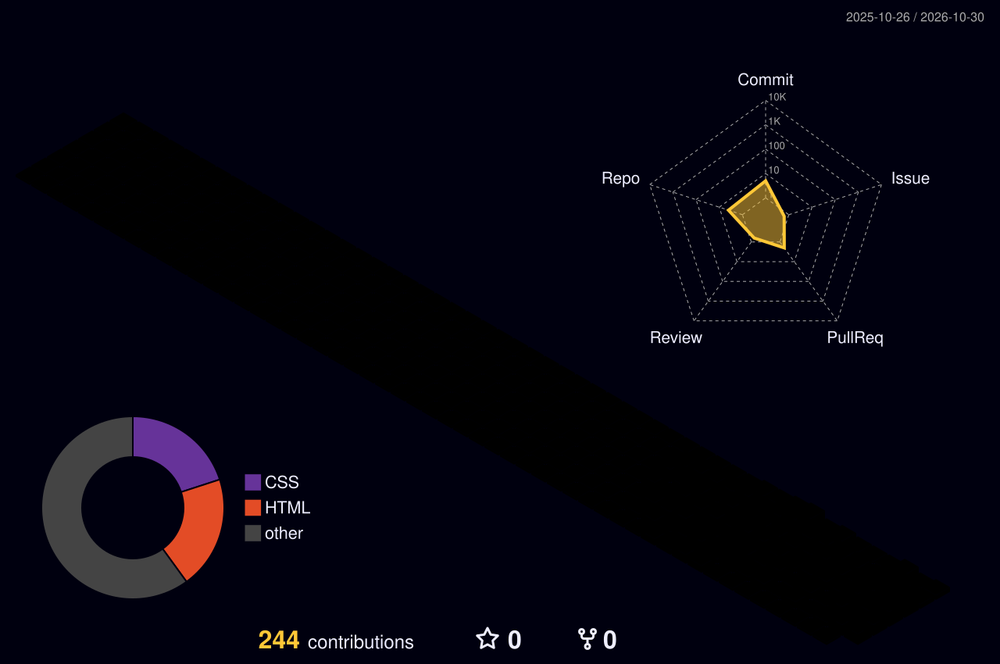

<div align="center">

  <!-- 1. Wave Header Banner -->
  

  <!-- 2. Signature Animated Celestial Geometry Emblem -->
  <a href="https://github.com/chki22" target="_blank">
    
  </a>

  <h2>🪐 오수아 (Frontend Engineer, AI Engineer)</h2>

 <!-- Real-time Typing SVG -->
<a href="https://github.com/chki22">
  
</a>

  <!-- 3D Glossy Badges -->
  <p>
    <a href="https://github.com/chki22" target="_blank">
      
    </a>
    <a href="https://github.com/chki22" target="_blank">
      
    </a>
    <a href="https://github.com/chki22" target="_blank">
      
    </a>
  </p>

  <!-- Social Badges -->
  <p>
    <a href="https://github.com/chki22" target="_blank">
      
    </a>
    <a href="mailto:osua52580@gmail.com">
      
    </a>
  </p>

  <br/>
  ---
  <br/>

  <!-- 3. 3D Core Pillars -->
  <h2>🧊 3D Core Pillars</h2>
  

  <br/><br/>

  <!-- 4. 3D Keycaps Skill Deck -->
  <h2>🎹 3D Tactile Skill Deck</h2>
  <p><sub>Interactive tactile keycaps and core engineering tech stacks ✨</sub></p>

  

  <br/><br/>

  <!-- 5. Visual R&D Lab -->
  <h2>🧪 Visual R&D Lab: Geometric &amp; Shader Observatory</h2>
  <p><sub>Visualizing mathematical geometry and GLSL shaders in the browser 🔭</sub></p>

  

  <br/><br/>

  <!-- 6. Spatial Architecture Matrix -->
  <h2>📐 Spatial Engineering &amp; Architecture Matrix</h2>
  <table width="100%">
    <tr>
      <td width="33%" align="center" valign="top">
        <br/><b>⚡ Zero-Stutter 60 FPS</b><br/><br/>
        <p>Decouple main UI thread and render loops with OffscreenCanvas &amp; Web Workers.</p>
      </td>
      <td width="33%" align="center" valign="top">
        <br/><b>🎯 1-Call Geometry Batching</b><br/><br/>
        <p>Batch 1,000+ objects into a single <code>InstancedMesh</code> to minimize draw calls.</p>
      </td>
      <td width="34%" align="center" valign="top">
        <br/><b>🛡️ Deterministic Verifier Loop</b><br/><br/>
        <p>Combine LangGraph RAG reasoning with rule-based safety verification pipelines.</p>
      </td>
    </tr>
  </table>

  <br/>

  <!-- 7. 3D Contribution Grass & Telemetry -->
  <h2>🌱 3D Contribution Grass &amp; Telemetry</h2>
  

  <br/><br/>

  <p>
    
    
  </p>

  <p>
    
  </p>

  <br/>

  <!-- 8. Orbital Roadmap -->
  <h2>🛰️ Orbital Roadmap: 2026 Trajectory</h2>
  <table width="100%">
    <tr>
      <td width="25%" align="left" valign="top"><b>🚀 Phase 01: Core Web</b><br/>High-performance rendering &amp; architecture</td>
      <td width="25%" align="left" valign="top"><b>🪐 Phase 02: Spatial Compute</b><br/>WebGPU compute shaders &amp; n-body physics</td>
      <td width="25%" align="left" valign="top"><b>🛰️ Phase 03: Agentic UI</b><br/>Autonomous AI-driven spatial interfaces</td>
      <td width="25%" align="left" valign="top"><b>🌌 Phase 04: Ecosystem</b><br/>Open-source contributions &amp; tech community</td>
    </tr>
  </table>

  <br/>

  <!-- 9. Celestial Observational Lounge -->
  <h2>🌌 Celestial Observational Lounge</h2>

```text
       ✦        .        🪐       .       ✦        .       ✨
             .              *               .       *
       .       ┌───────⟡ Cosmic Coordinate ⟡───────┐       .
           *   │  "Optimizing Frames, Architecting Logic,  │   .
    ✨         │   and Navigating the Spatial Cosmos."     │         🪐
       .       └───────────────────────────────────┘       *
             *        .          ✦         .         *
"Thank you for exploring this digital cosmos! Open for collaborations & tech discussions 🌌🛰️"
```

  

</div>
